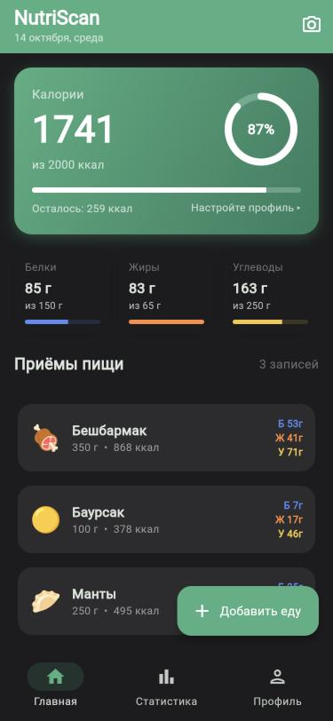
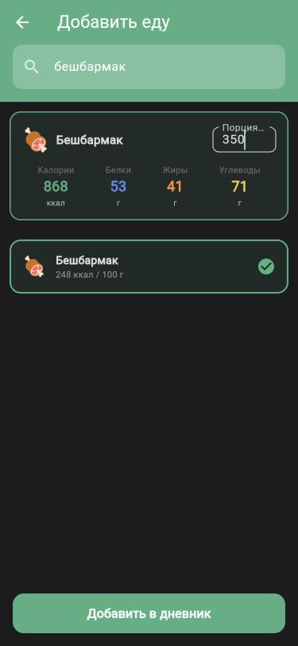
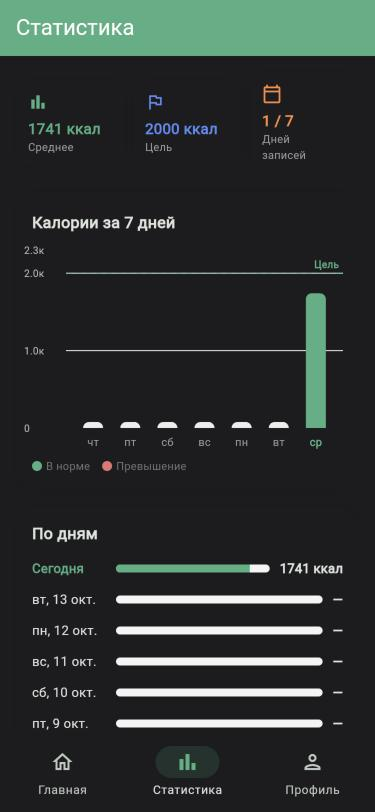
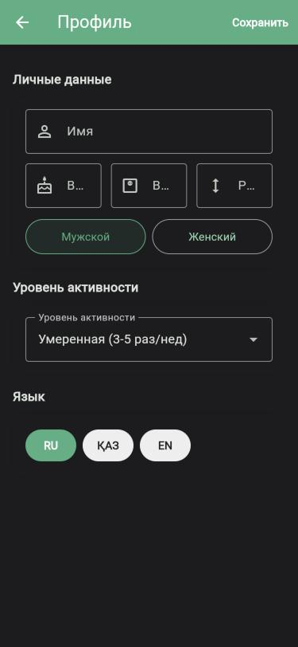

# NutriScan 🍽️

Take a photo of your meal and get its calories, protein, fat and carbs. A Flutter app with a FastAPI + PyTorch backend, with dedicated support for **Kazakh cuisine** — beshbarmak, baursak, manty and more.

| Food diary | Adding a dish | Weekly stats | Profile |
|---|---|---|---|
|  |  |  |  |

## Features

- 📸 **Recognize food from a photo** — the dish name plus calories and macros per portion
- 🇰🇿 **Kazakh dishes** — an own model for 14 national dishes that general food datasets don't cover
- 📒 **Food diary** — daily calories and macro progress against your goal, stored locally in SQLite (works on the web too)
- 🔎 **Manual entry** — search 115 dishes and set the portion size in grams
- 📊 **Weekly stats** — calories for the last 7 days against the goal
- 🎯 **Personal goal** — daily calories calculated from age, weight, height, sex and activity level (Mifflin–St Jeor)
- 🌐 **Three languages** — Kazakh, Russian and English

## How recognition works

The backend combines two models:

1. **Own Kazakh model** — EfficientNet-B0 fine-tuned on 14 Kazakh dishes (bauyrsak, beshbarmak, irimshik, kazy, kuirdak, kurt, lagman, manty, naryn, plov, samsa, shashlik, shelpek, sorpa). Trained with transfer learning in two phases: the classifier head first, then the whole network with a lower learning rate. The images were collected with [`collect_kazakh_dataset.py`](backend/collect_kazakh_dataset.py).
2. **Food-101 model** (101 international dishes) — a Vision Transformer via the Hugging Face Inference API, with a local fallback that averages predictions over 5 crops of the photo.

```
photo ─▶ Kazakh model ── confident (≥70%) and not "guessing"? ──▶ answer
               │ no
               ▼
         Food-101 model ── is this food at all? ── no ──▶ "no food recognised" + hint
               │ yes
               ▼
         top results (+ the Kazakh guess as an alternative if ≥40%) ──▶ answer
```

"Not guessing" is measured by the entropy of the Kazakh model's probabilities: if they are spread almost evenly, the photo is probably not a Kazakh dish and the request goes on to Food-101. Nutrition values come from a table per 100 g ([`nutrition_data.py`](backend/nutrition_data.py)) and are scaled to the portion.

## Architecture

The app follows **Clean Architecture** with **Riverpod**: each feature has its own `data` (data sources, repositories), `domain` (entities, use cases) and `presentation` (screens, notifiers) layers.

```
backend/                       FastAPI + PyTorch
  main.py                      /recognize endpoint, model pipeline
  train_kazakh_model.py        EfficientNet-B0 fine-tuning
  collect_kazakh_dataset.py    image collection for Kazakh dishes
  nutrition_data.py            nutrition per 100 g
mobile_app/lib/
  features/classification/     camera, recognition (API; on-device TFLite via platform channel prepared)
  features/diary/              diary, macro rings, weekly stats
  features/nutrition/          manual search and portions
  features/profile/            personal data, calorie goal, language
  core/                        theme, SQLite (mobile and web)
  l10n/                        kk, ru, en
```

## Tech stack

**Mobile:** Flutter, Dart, Riverpod, sqflite (+ web), fl_chart, image_picker<br>
**Backend:** Python, FastAPI, PyTorch, torchvision, Hugging Face Transformers, Pillow

## Getting started

**Backend** (Python 3.10+):

```bash
cd backend
python3 -m venv .venv && source .venv/bin/activate
pip install -r requirements.txt
uvicorn main:app --host 0.0.0.0 --port 8000
```

`HF_TOKEN` is optional: with it the Food-101 step uses the Hugging Face Inference API, without it a local model is downloaded on first use.

**Mobile app** (Flutter 3.x):

```bash
cd mobile_app
flutter pub get
flutter run --dart-define=API_HOST=192.168.1.5   # your computer's IP in the local network
```

On the web (`flutter run -d chrome`) the app talks to the backend on the same host, port 8000.
